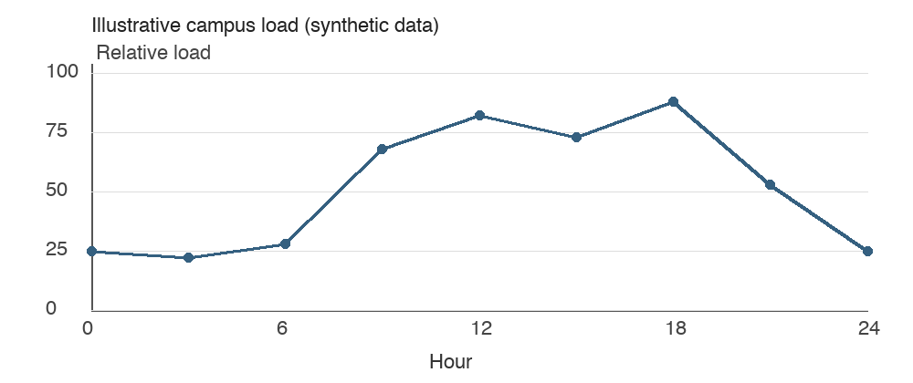

# 校园能源调度与设备运行分析

## 第一章 监测数据与用能规律

校园建筑的用电需求随课程安排、气温和设备运行状态变化。为了区分负荷增长与管理效率变化，首先需要在统一时间间隔内记录功率与运行时长。当采样周期为 \(\Delta t\) 时，时段电量可写为 \(E_t=P_t\Delta t\)。这项计算用于汇总监测数据，不意味着建筑在整个时段内始终保持相同的瞬时功率。对变化较快的设备，可以缩短采样周期，再比较累计电量的变化。

教学楼和实验楼的运行规律存在差异。教学楼负荷通常随上课时间变化，实验楼则可能存在需要连续运行的仪器。因此，调度方案应先保障必要设备，再安排可以调整时段的负荷。下图为用于排版演示的示意负荷曲线，不作为真实校园测量数据。

图 1 校园日负荷示意曲线

\begin{equation}
E_{\mathrm{day}}=\sum_{t=1}^{T}P_t\Delta t
\end{equation}

## 第三章 储能与供需约束

在给定时段内，供电、储能放电与建筑用电之间应保持平衡。储能容量限制决定了调度方案能够转移多少电量，而充放电功率限制决定了这种转移能有多快。下面将等式与不等式写成同一组约束，各行保留完整表达式，便于逐项阅读。章节从第一章跳到第三章是有意安排，用来检查编号是否读取实际章号。

\begin{equation}
\left\{\begin{array}{l}
P_t^{g}+P_t^{d}=L_t+P_t^{c}\\
0\leq P_t^{c}\leq P_{\max}^{c}\\
0\leq P_t^{d}\leq P_{\max}^{d}\\
E_{\min}\leq E_t\leq E_{\max}
\end{array}\right.
\end{equation}

储能效率会影响下一时段可使用的能量。比较不同运行方案时，需要将购电成本、循环损耗和供电可靠性一起考虑。表中的两个表达式分别用于计算电量与费用，表格中的公式保持行内形式。这样既能检查单元格内的公式转换，也能观察正文与表格采用不同缩进规则后的效果。

表 1 调度评估指标

<table><tr><th>指标</th><th>表达式</th></tr><tr><td>累计电量</td><td>\(E=\sum_{t=1}^{T}P_t\Delta t\)</td></tr><tr><td>购电费用</td><td>\(C=\sum_{t=1}^{T}c_tP_t^{g}\Delta t\)</td></tr></table>

## 第四章 热环境与方案评价

空调运行同时影响电力需求与室内热环境。对于围护结构，可以先用简化传热模型理解温差和导热系数的作用，再结合建筑实际边界条件开展计算。下面的方程只表达基本热传导关系；数值计算还需要材料参数、初始温度及边界条件。该公式保持无编号形式，用于验证同一文档可以同时包含有编号与无编号的行间公式。

\[
\rho c_p\frac{\partial T}{\partial t}=\nabla\cdot(k\nabla T)+q
\]

评价调度方案时，应分别检查电量、费用和舒适度。后续新增文字或公式后，再次运行同一宏，检查新增数量、章号与保存结果。

\begin{equation}
J=\sum_{t=1}^{T}c_tP_t^{g}\Delta t+\lambda\sum_{t=1}^{T}(T_t-T_{\mathrm{set}})^2
\end{equation}
